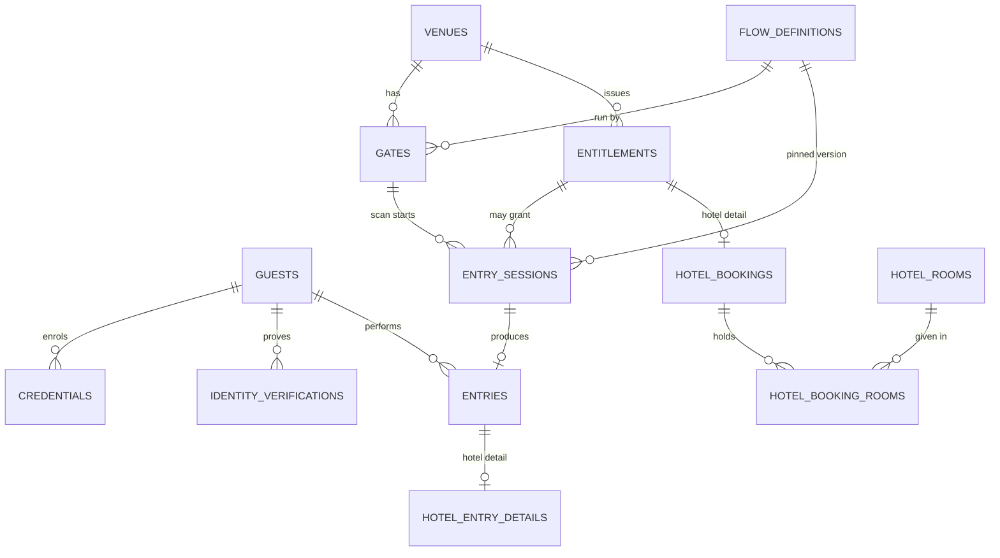

# ChqIn — data model

How the database is laid out, and why. The source of truth is the `*.schema.js` file in each module under `apps/api/src/modules/` (all collected in `apps/api/src/shared/db/schema.js`); this page explains the shape. For how an entrance works end to end, read `entry-flow-explained.md` first.

## The short answer

**One database: PostgreSQL.** There is no Redis and no object storage today.

| Store | Holds | Notes |
| --- | --- | --- |
| **PostgreSQL** | Everything: guests, credentials, venues, gates, flows, sessions, entries, staff, audit | WebAuthn challenges and rate limiting also live here for now (`webauthn_challenges`). |
| Redis | Not used | Add it when measurement shows challenges or sessions are the hot write. |
| Object storage | Not used | ID images are not kept. If a regulation ever requires it, the row stores a pointer and hash only. |

IDs are UUIDv7 generated in Node (`shared/lib/ids.js`), never by a database default. Time-ordered ids keep index inserts append-only without exposing a countable sequence. Tokens are stored as SHA-256 hashes, so a database leak is not a set of working keys.

The full table-and-relationship diagram is in [database-diagram.md](database-diagram.md).

## The structural decision

**Guests are global. Venues and entries are per-place.**

A ChqIn identity belongs to the guest, not the hotel. Gates, flows, sessions, entitlements and entries belong to a venue and carry `venue_id`. The identity tables never point into venue tables, so splitting them into two services later is a deployment change, not a rewrite.

## Naming

No prefix means any kind of gate can use the table. A prefix means it belongs to one kind of venue: `hotel_` today, `ticket_`, `slot_`, `permit_` or `event_` when those verticals arrive. Reading a table name tells you which gate it serves.

## Tables

### Identity domain (global)

| Table | Purpose |
| --- | --- |
| `guests` | A person. Contact details are keyed-hashed (`email_hmac`, `phone_hmac`) for lookup and encrypted (`email_enc`, `phone_enc`) for use. Status: active, suspended, erased. |
| `credentials` | One row per passkey. This is the login system. `credential_id` is unique; `sign_count` going backwards signals a cloned authenticator. |
| `identity_verifications` | KYC events, never the document: method, result, hashed document id, last four digits, the holder's name, date of birth and address as returned, and the consent that was shown. |
| `webauthn_challenges` | Single-use ceremony challenges with a short expiry, tied to an entry session. |
| `auth_events` | Append-only log of every ceremony. No foreign keys on purpose, so it can record an attempt against a credential that was just deleted and never blocks on another table's lock. |

### Venue domain

| Table | Purpose |
| --- | --- |
| `venues` | Anywhere someone arrives. `kind` is hotel, apartment, temple, station, office, monument, park, museum, event or other. `settings` (jsonb) holds what onboarding collected: services, guest-facing essentials, business registration, per-service contacts. `retention_days` sets how long entry history is kept. |
| `staff_users`, `staff_memberships`, `staff_sessions`, `staff_tokens` | Dashboard accounts, their role at a venue, revocable server-side sessions, and one-time email and reset tokens. |

`venues.status` is `active`, `suspended` or `closed`, set only by ChqIn Admin. A suspended venue's gates refuse scans and its staff cannot sign in. A closed venue is what deleting a venue with history leaves behind.

### ChqIn Admin (the platform team)

These tables belong to the ChqIn team, not to any venue. They are kept apart from `staff_*` on purpose, so one side's session can never be read as the other's. See [admin-panel.md](admin-panel.md).

| Table | Purpose |
| --- | --- |
| `admin_users` | An admin account. The email is stored keyed-hashed and encrypted. Password (scrypt), role (`owner`, `support` or `read_only`), status (`invited`, `active` or `disabled`), and a TOTP secret encrypted with `ENCRYPTION_KEY`, used only when `ADMIN_REQUIRE_2FA` is on. `totp_last_step` stops a code from working twice. The env owner (`ADMIN_EMAIL`) is synced into this table at startup. |
| `admin_sessions` | Revocable server-side sessions. The token is stored as a SHA-256 hash. `mfa_at` stays null until the TOTP code is accepted (when 2FA is off, the session is full from the password step). They expire after 30 minutes idle or 8 hours in total. |
| `admin_tokens` | Single-use invite and 2FA-reset links, stored hashed. |
| `admin_audit_log` | Append-only, with no foreign keys (the same reasoning as `auth_events`). Each row records who did it, their role, the action, the target, the venue, the reason, the before and after values of changed fields, the IP and the user agent. It is written in the same transaction as the change it describes. |

### The entry engine (any gate)

| Table | Purpose |
| --- | --- |
| `flow_definitions` | An ordered list of steps as JSON, versioned by `(key, version)`. Immutable once published. |
| `gates` | One physical way in. Points at a flow, carries its own QR token (hashed, plus the clear value for reprinting a counter card), a `kind` (qr, desk, turnstile, kiosk), a `config` jsonb for per-gate options, and a status of active or revoked. |
| `entitlements` | The thing that grants entry, if anything: booking, ticket, slot, permit, membership or event. The guest link is nullable, because a reservation exists before anyone knows who the guest is. `ref` is unique per venue and kind. Kind-specific detail nothing queries by sits in `data`. |
| `entry_sessions` | One guest's walk through a flow. Holds the cursor (an index into the steps), `state`, an append-only `trail` of what each step did and when, and a `version` that guards against two requests saving at once. Status: in_progress, waiting, done, rejected, expired, revoked. |
| `entries` | The audit record that someone got in. `guest_id` is nullable so erasure can tombstone a guest without deleting a record with a retention period, and so an open venue can record a count without a person. A unique idempotency key stops a double tap admitting twice. |

### Visitor and event tables (`visit_`, `event_`) and the outbox

Used by any venue that hosts visitors or runs events, The Nest first. Named for the capability, not the customer.

| Table | Purpose |
| --- | --- |
| `visit_hosts` | A person or team a visitor can ask to see, with an optional WhatsApp number. Also an event's organiser. |
| `visit_entry_details` | What a meeting or office-work arrival adds to an entry: purpose and host. |
| `event_events` | An event a visitor can check in to. Active or paused, with an organiser. |
| `event_entry_details` | What an event arrival adds to an entry: event, company, designation. |
| `outbox` | Notifications waiting to go out, for every kind of gate. Written in the same transaction as what caused them and sent by a worker afterwards. Status: pending, sent, failed, or cancelled (by an admin, so the row still says it existed). |

How a venue identifies people is decided in two places. ChqIn Admin gives or takes away Aadhaar per venue (`venues.settings.aadhaarAccess`, on unless set to `false`). Without it, everyone, hotel guests included, gives a name, date of birth and address (mobile optional), recorded as method `basic` and never claimed as verified, and no Aadhaar OTP can be requested. With it, a hotel always uses Aadhaar, and any other venue picks `basic` or `aadhaar` on its gates (`gates.config.identity`).

The basic form is the venue's own (`venues.settings.identityForm`, set on the dashboard's Identification page): the name is always asked; date of birth, address and mobile are each required, optional or off; and up to ten extra questions (free text or a pick-list, each optionally required). Answers to the extra questions are stored on the check as `identity_verifications.subject_extra`, `{ "<question>": "<answer>" }` (migration 0019).

A passkey made after a basic check proves the phone, not the person. At a venue that uses Aadhaar, someone who has never passed an Aadhaar check (anywhere) unlocks their passkey and then does Aadhaar once; after that the passkey is enough. Check-in refuses them (`aadhaar_required`) until they have.

### Hotel tables (`hotel_`)

| Table | Purpose |
| --- | --- |
| `hotel_rooms` | Rooms at a venue. `(venue_id, number)` is unique. |
| `hotel_bookings` | What a booking adds to an entitlement: guest name as booked, arrival and departure dates, party size, rooms requested, stay status. Shares its id with the entitlement row. |
| `hotel_booking_rooms` | The rooms a booking actually holds. A row per room, because a party can take two. The only record of which rooms are given out. |
| `hotel_entry_details` | What an arrival adds to an entry: which room, the journey (returning, newDevice, firstTime, desk), nights, party size. |

## How a hotel check-in writes

1. Guest scans the gate QR. The server finds the gate and creates an `entry_sessions` row on the gate's flow version.
2. The runner walks the steps: `identify`, `match_booking`, `admit`. A step that finishes instantly costs no extra write.
3. `admit` writes the `entries` row, its `hotel_entry_details`, marks the booking, and closes the session, all in one transaction.

That is one write per guest when nothing waits, two when a step has to wait (an approval, a payment).

## Rules that hold everywhere

- **Admit is atomic.** The entry, the entitlement update and the session close commit together or not at all.
- **No external calls inside a transaction.** WhatsApp, payments and similar go through an outbox when they arrive.
- **Published flows never change.** A session is pinned to the row it started on. Changing a flow means publishing version N+1.
- **Every venue-scoped query filters by `venue_id`.** A session's venue comes from its gate, and booking lookups use the session's venue. A guest cannot reach another venue's bookings.
- **Concurrent saves are safe.** A session save is `UPDATE … WHERE id = $1 AND version = $2`. The loser re-reads and re-runs.

## Growth plan

These stages are estimates, not measurements. Measure before adding each one.

| Stage | Trigger | Move |
| --- | --- | --- |
| 1 | Launch | One Postgres primary, backups, indexes as they are. |
| 2 | `auth_events` or `entries` grows large | Monthly range partitions through a hand-written migration (Drizzle cannot express `PARTITION BY`). Detach and archive old months. |
| 3 | Dashboard reads slow the guest path | Send staff and reporting reads to a replica. |
| 4 | Reporting hurts OLTP | Stream changes to an analytics store. Never run analytics on the primary. |
| 5 | Sessions or challenges become the hottest write | Move them to Redis with a TTL. |
| 6 | Very high sustained writes, or data residency | Split identity from entries into two clusters. Shard venue data by `venue_id`, never by `guest_id`, since one guest appears at many venues. |

## Privacy and retention

- **Never store biometrics.** The passkey public key is the only credential artifact. It is not secret, but it is a cross-venue identifier, so treat it as personal data.
- **Encrypt what identifies.** Contact details are encrypted; lookups use keyed hashes.
- **Do not keep ID images.** Keep the result, the hashed identifier, and the last four digits.
- **Open venues need not record people.** An open gate can skip `identify` and record a count only. A database of which named person entered which temple on which day is a movement-tracking system regardless of intent.
- **Erasure is not deletion of the record.** Deleting an account clears the guest and cascades their credentials, but entries have a statutory retention period. `entries.guest_id` is set to null (a tombstone) rather than deleting the row.
- **Local registers are regulated.** India has hotel-register rules and Form C reporting for foreign nationals. Confirm specifics for your jurisdiction and add a `regulatory_filings` table when needed. Do not bolt it onto `entries`.

## Not built yet

Payments, loyalty, room keys, PMS sync, WhatsApp, and the other verticals' tables (`ticket_`, `slot_`, `permit_`, `event_`). Each arrives with its first real venue.
