# ChqIn database diagram

**A Reusable Arrival Mechanism.** Every kind of arrival (a hotel check-in, a workplace visit, a meetup) runs through the same engine: a gate starts a session, the session walks a flow, and the result is one audit record. Only the flow and a few capability tables differ.

For what each table holds and why, see [data-model.md](data-model.md). For how an entrance works end to end, see [entry-flow-explained.md](entry-flow-explained.md).

## Diagram

```mermaid
erDiagram
    %% ---------- Identity (global) ----------
    guests ||--o{ credentials : "enrols passkeys"
    guests ||--o{ identity_verifications : "is verified by"
    guests ||--o{ webauthn_challenges : "ceremonies"

    %% ---------- Venue and staff ----------
    venues ||--o{ staff_memberships : "has staff"
    staff_users ||--o{ staff_memberships : "works at"
    staff_users ||--o{ staff_sessions : "signs in"
    staff_users ||--o{ staff_tokens : "reset / verify"
    venues ||--o{ staff_sessions : "scoped to"

    %% ---------- The entry engine ----------
    venues ||--o{ gates : "has doors"
    flow_definitions ||--o{ gates : "run by"
    gates ||--o{ entry_sessions : "each scan starts"
    flow_definitions ||--o{ entry_sessions : "pinned version"
    venues ||--o{ entry_sessions : "scoped to"
    guests ||--o{ entry_sessions : "walks"
    entitlements ||--o{ entry_sessions : "may grant"
    entry_sessions ||--o{ webauthn_challenges : "during"
    entry_sessions ||--o| entries : "ends in"
    venues ||--o{ entitlements : "issues"
    guests ||--o{ entitlements : "holds"
    venues ||--o{ entries : "audit"
    gates ||--o{ entries : "through"
    guests ||--o{ entries : "performs"
    entitlements ||--o{ entries : "used for"
    credentials ||--o{ entries : "authenticated by"
    venues ||--o{ outbox : "notifications"

    %% ---------- ChqIn Admin (the platform team) ----------
    admin_users ||--o{ admin_sessions : "signs in"
    admin_users ||--o{ admin_tokens : "invite / 2FA reset"

    %% ---------- Hotel (hotel_) ----------
    venues ||--o{ hotel_rooms : "has"
    entitlements ||--o| hotel_bookings : "hotel detail"
    hotel_bookings ||--o{ hotel_booking_rooms : "holds"
    hotel_rooms ||--o{ hotel_booking_rooms : "given in"
    entries ||--o| hotel_entry_details : "hotel detail"
    hotel_rooms ||--o{ hotel_entry_details : "room"

    %% ---------- Visitors (visit_) and events (event_) ----------
    venues ||--o{ visit_hosts : "has"
    venues ||--o{ event_events : "runs"
    visit_hosts ||--o{ event_events : "organises"
    entries ||--o| visit_entry_details : "visit detail"
    visit_hosts ||--o{ visit_entry_details : "visited"
    entries ||--o| event_entry_details : "event detail"
    event_events ||--o{ event_entry_details : "attended"

    guests {
        uuid id PK
        text display_name
        bytea email_hmac
        bytea phone_enc
        text status
    }
    credentials {
        uuid id PK
        uuid guest_id FK
        text credential_id UK
        bigint sign_count
        timestamptz revoked_at
    }
    identity_verifications {
        uuid id PK
        uuid guest_id FK
        uuid session_id
        text method "aadhaar_otp, basic, simulated, ..."
        text result
    }
    webauthn_challenges {
        uuid id PK
        uuid session_id FK
        uuid guest_id FK
        text purpose
        timestamptz consumed_at
    }
    auth_events {
        uuid id PK "no foreign keys on purpose"
        timestamptz occurred_at
        text event
        text outcome
    }
    venues {
        uuid id PK
        text kind "hotel, office, ..."
        text name
        text timezone
        jsonb settings
        text status "active, suspended, closed"
    }
    staff_users {
        uuid id PK
        text display_name
        text status
    }
    staff_memberships {
        uuid id PK
        uuid staff_id FK
        uuid venue_id FK
        text role
    }
    staff_sessions {
        uuid id PK
        uuid staff_id FK
        uuid venue_id FK
        timestamptz revoked_at
    }
    staff_tokens {
        uuid id PK
        uuid staff_id FK
        text purpose
    }
    flow_definitions {
        uuid id PK
        text key "hotel, visitor.host_approval"
        int version
        jsonb steps
    }
    gates {
        uuid id PK
        uuid venue_id FK
        uuid flow_id FK
        text kind
        bytea token_hash UK
        jsonb config "identity: basic or aadhaar"
        text status
    }
    entitlements {
        uuid id PK
        uuid venue_id FK
        uuid guest_id FK
        text kind "booking, ticket, slot, ..."
        text ref
        text status
    }
    entry_sessions {
        uuid id PK
        uuid venue_id FK
        uuid gate_id FK
        uuid flow_id FK
        uuid guest_id FK
        uuid entitlement_id FK
        int cursor
        int version
        jsonb state
        jsonb trail
        text status
    }
    entries {
        uuid id PK
        uuid venue_id FK
        uuid gate_id FK
        uuid session_id FK
        uuid guest_id FK
        uuid entitlement_id FK
        text idempotency_key UK
        text outcome
    }
    outbox {
        uuid id PK
        uuid venue_id FK
        text kind
        jsonb payload
        text status
        int attempts
    }
    admin_users {
        uuid id PK
        bytea email_hmac UK
        text role "owner, support, read_only"
        text status
        bytea totp_secret_enc
    }
    admin_sessions {
        uuid id PK
        uuid admin_id FK
        bytea token_hash UK
        timestamptz mfa_at
        timestamptz revoked_at
    }
    admin_tokens {
        uuid id PK
        uuid admin_id FK
        text purpose "invite, totp_reset"
    }
    admin_audit_log {
        uuid id PK "no foreign keys on purpose"
        uuid admin_id
        text action
        text target_type
        text target_id
        text reason
        jsonb changes
    }
    hotel_rooms {
        uuid id PK
        uuid venue_id FK
        text number
    }
    hotel_bookings {
        uuid entitlement_id PK, FK
        text guest_name
        date arrival_date
        date departure_date
        text status
    }
    hotel_booking_rooms {
        uuid booking_id FK
        uuid room_id FK
    }
    hotel_entry_details {
        uuid entry_id PK, FK
        uuid room_id FK
        text journey
    }
    visit_hosts {
        uuid id PK
        uuid venue_id FK
        text name
        text phone
        boolean active
    }
    visit_entry_details {
        uuid entry_id PK, FK
        uuid host_id FK
        text purpose
    }
    event_events {
        uuid id PK
        uuid venue_id FK
        uuid organizer_id FK
        text name
        boolean active
    }
    event_entry_details {
        uuid entry_id PK, FK
        uuid event_id FK
        text company
        text designation
    }
```

## How to read it

- **Identity (top):** `guests`, `credentials`, KYC records and challenges belong to the person, never to a venue. The same ChqIn identity works at every venue.
- **Engine (middle):** a `gate` runs a pinned `flow_definitions` version. Each scan creates an `entry_sessions` row. A finished session ends in one `entries` row, which is the audit record.
- **Capabilities (bottom):** `hotel_` for rooms and bookings, `visit_` for hosts, `event_` for events and attendance. A new kind of venue adds its own prefix and leaves the engine tables alone.
- **`auth_events`** has no links on purpose, so it can log an attempt against something that was just deleted.
- **Admin (`admin_`):** the ChqIn team's own accounts, separate from venue staff. `admin_audit_log` has no links for the same reason as `auth_events`: it has to outlive whatever it names. See [admin-panel.md](admin-panel.md).

## Delete rules worth knowing

- Deleting a venue deletes its gates, hosts, events, rooms, staff memberships and outbox messages.
- A venue cannot be deleted while it still has entries or sessions. That history is the audit trail.
- Deleting a guest keeps their entries, with the guest link set to null.
- Deleting an event keeps past attendance, with the event link set to null.
- A gate belongs to exactly one venue.
- ChqIn Admin "deletes" a venue that has history by **closing** it (status `closed`, gates revoked, sessions ended). Only a venue with no entries or sessions is really deleted.
- Erasing a guest from ChqIn Admin deletes the guest row and scrubs their personal data elsewhere. Their entries stay, with no guest attached.
