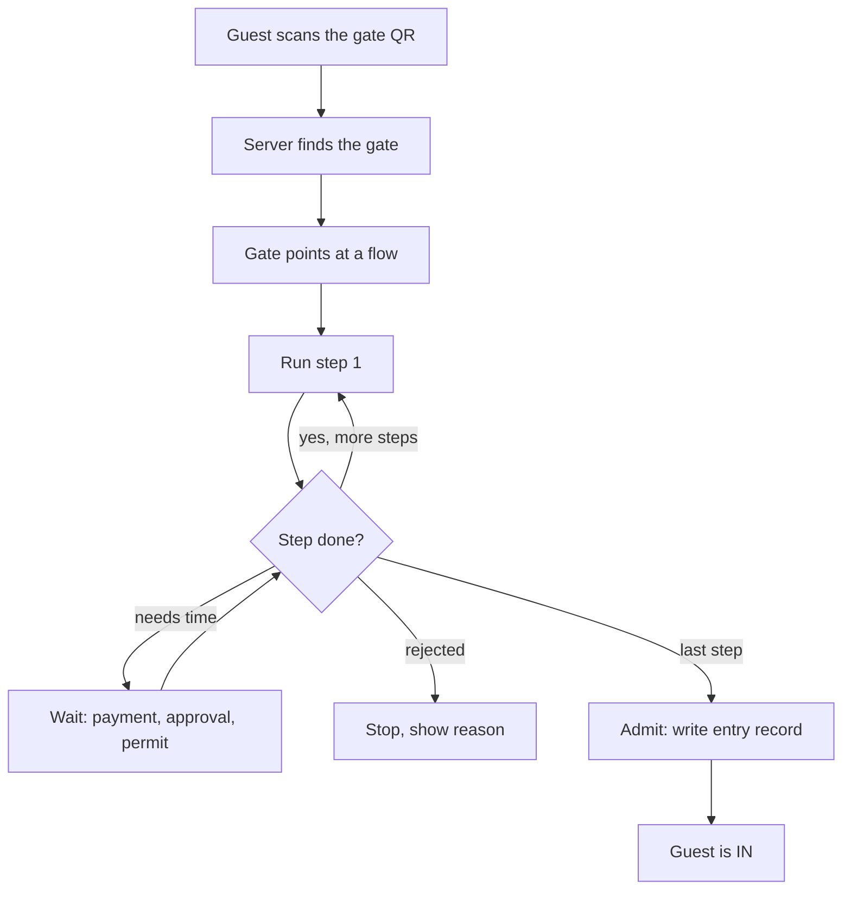

# How ChqIn handles every entrance (simple version)

## The problem

Every entrance lets people in differently. A hotel checks a booking. A zoo takes payment. A temple gives a time slot. A national park needs a permit. A trade fair wants registration. The Nest asks who you are visiting and waits for that person to approve.

If we build one module per entrance, we will be writing code forever.

## The idea

**Every entrance is the same thing: a list of small steps, done in order.** Only the list changes. The code that runs the list never changes.

Think of it like a pizza order. The kitchen has the same toppings for everyone (steps). Each customer picks which toppings go on (the list). Nobody builds a new kitchen for each pizza.

## The four building blocks

| Block | What it is | Example |
| --- | --- | --- |
| **Venue** | The place | The Nest, Guwahati Zoo, a hotel |
| **Gate** | One physical way in | Main QR at the lobby, ropeway turnstile |
| **Flow** | The ordered list of steps a gate runs | Identify, Pay, Pass, IN |
| **Step** | One reusable action | Pay, Pick slot, Staff approves |

A venue has many gates. Each gate points at one flow. A flow is made of steps.

## The step library

We build these once and reuse them everywhere. Built today: Identify, Match booking, Collect details, Staff approves and Admit. The rest are added when the first venue needs them.

The full list:

- **Identify**: who is this person (ChqIn identity, Aadhaar scan)
- **Collect details**: a form (company, designation, purpose)
- **Pay**: collect money
- **Pick slot**: choose a time window
- **Register**: sign up for an event
- **Requirements / Permit**: check rules, check a permit
- **Validate ticket**: scan a ticket someone already holds
- **Match booking**: find the guest's hotel booking
- **Staff approves**: wait for a person to say yes (WhatsApp, dashboard)
- **Issue pass**: give a QR or pass
- **Admit**: record the entry. This is always the last step.

## Your 6 formats are just 6 lists

| Format | The list |
| --- | --- |
| PAY → IN | Pay, Issue pass, Admit |
| TICKET → IN | Validate ticket, Admit |
| REGISTER → IN | Collect details, Register, Issue pass, Admit |
| PAY + REGISTER → IN | Collect details, Pay, Issue pass, Admit |
| SLOT → IN | Pick slot, Confirm, Admit |
| PERMIT → IN | Requirements, Permit check, Admit |

And the places we already have or are building:

| Place | The list |
| --- | --- |
| Hotel | Identify, Match booking, Admit |
| The Nest (built) | Identify, Collect details (purpose), then for a meeting: Collect details (host), Staff approves; for an event: Collect details (event, company, designation); then Admit |

The only "smart" thing a flow can do is skip a step with a **`when`** condition ("run this step only if the visitor picked meeting"). Two steps with different conditions give you a branch, and a guest's position stays a single number. The Nest needs it. Nothing else does yet.

## What happens when a guest arrives

Three outcomes for any step: **go on to the next step**, **wait** (guest is paying, staff has not replied yet), or **reject** (permit denied). That is the whole engine.

The guest app does not know about hotels or zoos. It asks "what is my current step?" and draws the right screen for it.

## What lives where in the database

- `venues`: the place.
- `gates`: which door, and which flow it runs. Each has its own QR token.
- `flow_definitions`: the list of steps, saved as JSON, versioned, never edited once published. Changing a flow means publishing the next version. A guest already mid-journey stays on the version they started on.
- `entry_sessions`: one guest's journey through a flow. It holds a "current step" number, the answers so far, and an append-only `trail` of what each step did and when. A `version` number stops two requests saving over each other.
- `entitlements`: the thing that grants entry, if any: booking, ticket, slot, permit, membership or event.
- `entries`: the final record that someone got in.
- `hotel_` tables: rooms, booking details and arrival details that only a hotel needs. Other kinds of gate get their own prefix later.

The guest's identity stays global and separate. The same ChqIn identity works at the hotel, the zoo and the temple. See `data-model.md` for every table.

## Open places (temples, public monuments)

Recording "this named person entered this temple today" is a movement-tracking system. So for open venues the Identify step can be turned off, and the entry record then stores only a count, not a person.

## Who sets up a gate

The ChqIn team only, for now. We pick a format, set the options (price, slots, approvers) and publish. Venues cannot edit flows. A self-serve builder can be added later on the same tables, with no rewrite.

## How we get there

1. **Hotel** (done): the hotel check-in runs as a flow. The guest app and API responses are unchanged.
2. **The Nest**: adds Collect details, Staff approves and Register.
3. **Pay, Slot, Permit, Validate ticket**: each is added when the first real venue needs it.

We build a new step only when a genuinely new capability appears (for example a physical turnstile that needs to be told "open"). A new format made from existing steps is a config change, not a code change.

## One-line summary

**Gate → Flow → Steps → Admit.** New entrance type means a new list, not new code.
